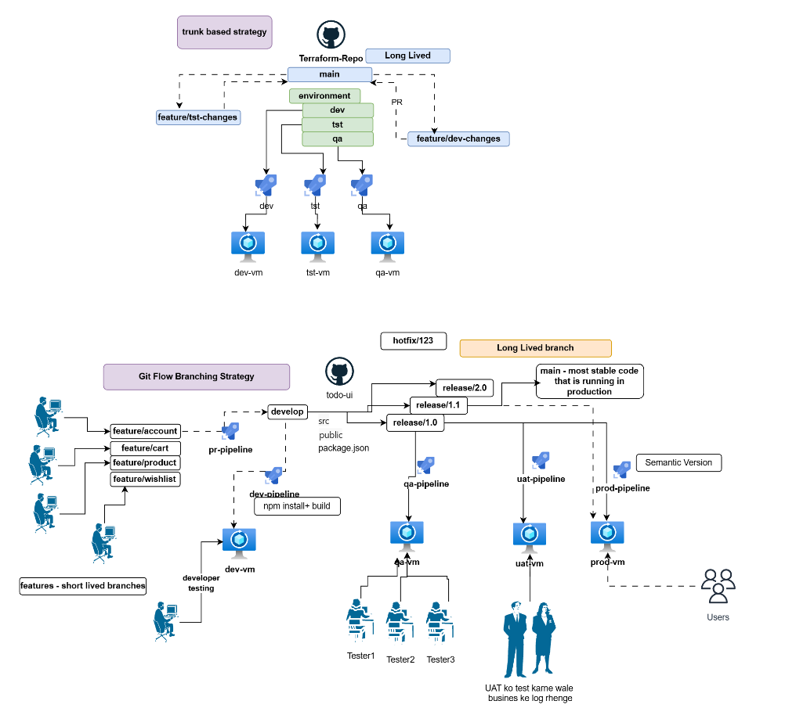
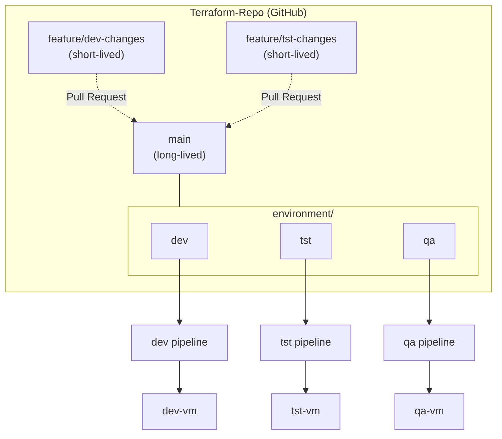
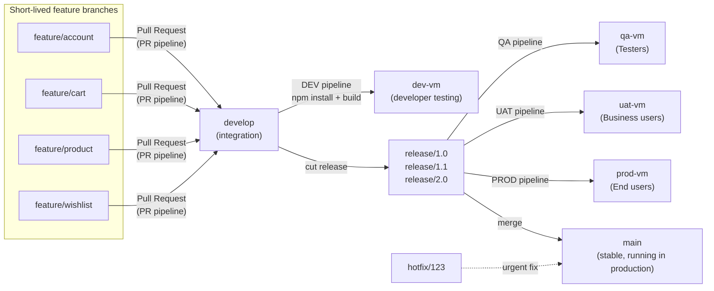
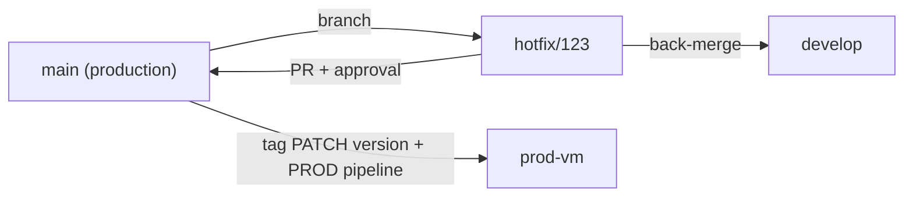

# Git Branching Strategy & CI/CD Pipeline with Environment-Based Deployments


Documentation of two Git workflows and the CI/CD promotion model around them: **trunk-based development** for infrastructure code and **Git Flow** for application releases, with deployments across DEV, QA, UAT and PROD.

<p align="center">
  
</p>

*Upper section: trunk-based strategy (Terraform repo). Lower section: Git Flow strategy (todo-ui repo).*

---

## At a Glance

The diagram shows two separate workflows. They are not one branching model, and each can be adopted on its own or combined (see [Hybrid options](#hybrid-options)).

| | A: Trunk-based | B: Git Flow |
|---|---|---|
| Repository in diagram | `Terraform-Repo` | `todo-ui` |
| Typical use | Infrastructure as Code | Versioned application releases |
| Long-lived branches | `main` | `main`, `develop` |
| Short-lived branches | `feature/dev-changes`, `feature/tst-changes` | `feature/*`, `release/*`, `hotfix/*` |
| Integration point | `main` via pull request | `develop` via pull request |
| Environments | `dev-vm`, `tst-vm`, `qa-vm` | `dev-vm`, `qa-vm`, `uat-vm`, `prod-vm` |
| Release ceremony | Light | Formal: QA, then UAT, then PROD |

## Contents

- [Pattern A: Trunk-based (Terraform)](#pattern-a-trunk-based-terraform)
- [Pattern B: Git Flow (todo-ui)](#pattern-b-git-flow-todo-ui)
- [CI/CD pipelines](#cicd-pipelines)
- [Environments](#environments)
- [Versioning](#versioning)
- [Hotfixes](#hotfixes)
- [Branch naming and protection](#branch-naming-and-protection)
- [Hybrid options](#hybrid-options)
- [Assumptions](#assumptions)
- [Repository structure](#repository-structure)
- [Git Flow in this repository](#git-flow-in-this-repository)
- [Status and Roadmap](#status-and-roadmap)
- [Author](#author)

---

## Pattern A: Trunk-based (Terraform)

`main` is the only long-lived branch. Engineers make small changes on short-lived branches and merge them back through pull requests. Environment configuration lives under `environment/` (`dev`, `tst`, `qa`), and each environment has its own pipeline that deploys to its own VM.



**Workflow**

1. Branch from the latest `main`.
2. Make a small, focused change, for example in one environment folder.
3. Open a pull request to `main`. Automated checks run.
4. A reviewer approves and the change is merged. The branch is deleted.
5. The environment pipeline applies the change to its VM.

**Controls that support this workflow**

| Control | Purpose |
|---|---|
| `terraform fmt -check` and `terraform validate` | Catch formatting and configuration errors early |
| `terraform plan` posted to the PR | Shows reviewers exactly what will change |
| Security scan (for example `tfsec`, `checkov`) | Flags insecure infrastructure before merge |
| Required review and CODEOWNERS | Peer review, with owner approval for sensitive environments |
| Branch protection on `main` | No direct pushes, required status checks |
| One pipeline per environment | `dev`, `tst` and `qa` deploy independently |

The recommended promotion order is `dev`, then `tst`, then `qa`.

---

## Pattern B: Git Flow (todo-ui)

`todo-ui` is a Node.js UI project. Developers work on short-lived feature branches that merge into `develop`. When `develop` holds the scope for a release, a release branch is cut and promoted through QA and UAT before production.



**Branches**

| Branch | Lifetime | Purpose |
|---|---|---|
| `main` | Long-lived | Most stable code, the code running in production |
| `develop` | Long-lived | Integration branch, source of DEV builds and release branches |
| `feature/account`, `feature/cart`, `feature/product`, `feature/wishlist` | Short-lived | One feature each |
| `release/1.0`, `release/1.1`, `release/2.0` | Temporary | Release stabilization and promotion |
| `hotfix/123` | Short-lived | Example urgent production fix |

**Feature flow**

1. Branch from `develop` into `feature/<name>`.
2. Open a pull request into `develop`. The PR pipeline runs.
3. After review, merge. The DEV pipeline runs `npm install` and a build, then deploys to `dev-vm`.
4. Developers test on `dev-vm`.

**Release stabilization**

1. Create `release/<version>` from `develop`.
2. Freeze features. Only bug fixes, documentation and release metadata are allowed.
3. Promote the release candidate through QA, UAT and PROD.
4. Fixes found along the way are committed to the release branch and re-validated.
5. On approval, merge to `main`, tag the version and deploy.
6. Merge the release branch back into `develop` so fixes are not lost.

A release branch isolates a release candidate from ongoing feature work, so `develop` keeps moving while QA and UAT test a stable snapshot.

**Who validates what**

| Stage | Environment | Performed by | Focus |
|---|---|---|---|
| Developer testing | `dev-vm` | Developers | Smoke checks on the latest `develop` |
| QA | `qa-vm` | Testers (Tester1, Tester2, Tester3 in the diagram) | Functional, regression and integration testing |
| UAT | `uat-vm` | Business stakeholders | Confirms the release meets business requirements |
| Production | `prod-vm` | End users | Live use after approval |

The diagram annotates UAT with a Hindi note: *"UAT ko test karne wale business ke log rahenge"*, meaning UAT is performed by business users.

---

## CI/CD Pipelines

| Pipeline | Pattern | Typical trigger | Responsibilities | Target |
|---|---|---|---|---|
| `dev`, `tst`, `qa` (infra) | A | Merge to `main` touching that environment | Terraform init, validate, plan, apply | `dev-vm`, `tst-vm`, `qa-vm` |
| PR pipeline | B | Pull request to `develop` | Install, lint, test, build check | None |
| DEV pipeline | B | Push to `develop` | `npm install`, build, deploy | `dev-vm` |
| QA pipeline | B | Release branch created or updated | Build release candidate, deploy | `qa-vm` |
| UAT pipeline | B | QA sign-off | Promote the QA-approved build | `uat-vm` |
| PROD pipeline | B | UAT sign-off and manual approval | Promote the approved build, tag version | `prod-vm` |

Principles:

- **Build once, deploy many.** Promote the same artifact from QA to UAT to PROD instead of rebuilding.
- **Gate each promotion.** QA sign-off before UAT, UAT sign-off before PROD.
- **Fail fast.** Lint and tests run in the PR pipeline, before code reaches `develop`.
- **Traceability.** Every deployment maps to a commit SHA and, for releases, a version tag.
- **Manual approval for PROD.**

Starter templates are in [`pipelines/`](pipelines/). The pipeline icons in the diagram resemble Azure Pipelines, so the templates use that syntax. The same stages translate to GitHub Actions.

| File | Pattern | Purpose |
|---|---|---|
| [`pr-pipeline.yml`](pipelines/pr-pipeline.yml) | B | Lint, test and build on pull requests to `develop` |
| [`dev-pipeline.yml`](pipelines/dev-pipeline.yml) | B | Build and publish on every merge to `develop` |
| [`release-pipeline.yml`](pipelines/release-pipeline.yml) | B | Build once, then QA, UAT and PROD stages |
| [`terraform-env-pipeline.yml`](pipelines/terraform-env-pipeline.yml) | A | Terraform init, validate, plan and apply for one environment |

---

## Environments

| Environment | VM | Pattern | Purpose | Audience |
|---|---|---|---|---|
| DEV | `dev-vm` | A and B | Early integration and developer testing | Developers |
| TST | `tst-vm` | A | Testing of infrastructure changes | Engineers |
| QA | `qa-vm` | A and B | Functional and regression testing | Testers |
| UAT | `uat-vm` | B | Business acceptance testing | Business stakeholders |
| PROD | `prod-vm` | B | Live production | End users |

---

## Versioning

Releases follow [Semantic Versioning](https://semver.org/): `MAJOR.MINOR.PATCH`.

| Segment | Increment when | Example |
|---|---|---|
| MAJOR | Breaking changes | `1.x.x` to `2.0.0` |
| MINOR | Backward-compatible new functionality | `1.0.0` to `1.1.0` |
| PATCH | Backward-compatible fixes, including hotfixes | `1.1.0` to `1.1.1` |

The diagram labels release branches `release/1.0`, `release/1.1` and `release/2.0`. In this README, branch names identify the release line, and Git tags carry the full version (`v1.0.0`, `v1.1.0`, `v2.0.0`).

```bash
git checkout main
git merge --no-ff release/1.0
git tag -a v1.0.0 -m "Release 1.0.0"
git push origin main --tags
```

Changes per release are listed in [CHANGELOG.md](CHANGELOG.md).

---

## Hotfixes

`hotfix/123` is the example hotfix branch in the diagram. Here `123` is assumed to be a ticket number. A hotfix fixes a critical production defect without waiting for the next planned release.



```bash
git checkout main && git pull
git checkout -b hotfix/123
# implement and test the fix, open a PR into main
git tag -a v1.1.1 -m "Hotfix 123"
git push origin --tags
# merge the fix back into develop (or the active release branch)
```

More commands are in [docs/git-flow-commands.md](docs/git-flow-commands.md).

---

## Branch Naming and Protection

| Type | Pattern | Example |
|---|---|---|
| Feature | `feature/<short-name>` | `feature/cart` |
| Release | `release/<major>.<minor>` | `release/1.1` |
| Hotfix | `hotfix/<ticket-id>` | `hotfix/123` |
| Infrastructure change (Pattern A) | `feature/<env>-changes` | `feature/dev-changes` |

Recommended protection:

| Branch | Rules |
|---|---|
| `main` | No direct pushes, PR required, status checks required, restricted merge rights |
| `develop` | No direct pushes, PR required, PR pipeline must pass |
| `release/*` | PR required for fixes, restricted to release owners |
| `feature/*`, `hotfix/*` | Delete after merge |

---

## Hybrid Options

| Choose trunk-based when | Choose Git Flow when |
|---|---|
| You deploy often and want little branching overhead | You ship scheduled, versioned releases |
| Automated tests and feature flags are in place | Formal QA and UAT sign-off is mandatory |
| Changes are small and independent, as is typical for IaC | Several release versions must be supported |

The two can be combined:

- **Different repositories, different strategies.** Trunk-based for infrastructure, Git Flow for the application. This is what the diagram shows.
- **Trunk-based application with release tags.** Drop `develop`, merge features straight to `main` behind feature flags, and cut `release/*` only when a hotfix line is needed.
- **Git Flow with short cycles.** Keep `develop` and release branches, but release often and keep features very short-lived.
- **Environment promotion for IaC.** Add `uat` and `prod` environments to the Terraform structure and apply the same QA, UAT and PROD gates.

---

## Assumptions

The diagram is the source of truth. Where it is ambiguous or silent, this README makes the assumptions below.

| # | Area | What the diagram shows | Assumption |
|---|---|---|---|
| 1 | Environments (A) | `dev`, `tst`, `qa` grouped under an `environment` box inside `main` | Folders or configurations in `main`, not long-lived branches |
| 2 | PR direction (A) | Dashed arrows between feature branches and `main`, labeled "PR" | Branches are created from `main` and merged back by PR |
| 3 | Feature mapping (A) | `feature/dev-changes`, `feature/tst-changes` | Each changes the configuration of the environment in its name |
| 4 | Promotion order (A) | Three parallel pipelines | `dev`, then `tst`, then `qa`. Not an explicit arrow in the diagram |
| 5 | Release names (B) | `release/1.0`, `release/1.1`, `release/2.0` | Used as shown. Tags use full SemVer, for example `v1.0.0` |
| 6 | Release to pipeline (B) | Connectors from release branches to QA, UAT and PROD pipelines | The same release candidate is promoted QA, then UAT, then PROD. The exact wiring is not fully legible |
| 7 | Merge into `main` (B) | Arrow from the release area to `main` | Release branches merge into `main` on approval |
| 8 | Back-merge (B) | Not shown | Added as standard Git Flow practice |
| 9 | Hotfix flow (B) | `hotfix/123` has no connectors | Branched from `main`, merged to `main` and back into `develop` |
| 10 | "Long Lived" labels (B) | Orange label near the release and hotfix area | Applies to `main` and `develop`. Release and hotfix branches are temporary |
| 11 | PR pipeline (B) | Connector from `feature/account` to the PR pipeline | Applies to all feature branches |
| 12 | CI tool | Pipeline icons resembling Azure Pipelines | Templates use Azure Pipelines syntax. GitHub Actions is an equivalent |
| 13 | Production for A | No `prod` environment shown | Out of scope |
| 14 | `hotfix/123` | Label only | `123` is a ticket number |

---

## Repository Structure

```text
.
├── .github/
│   ├── CODEOWNERS
│   └── pull_request_template.md
├── docs/
│   ├── git-flow-commands.md
│   └── images/
│       └── architecture-diagram.png
├── pipelines/
│   ├── pr-pipeline.yml
│   ├── dev-pipeline.yml
│   ├── release-pipeline.yml
│   └── terraform-env-pipeline.yml
├── terraform/
│   └── environment/
│       ├── dev/
│       ├── tst/
│       └── qa/
├── .gitignore
├── CHANGELOG.md
├── LICENSE
└── README.md
```

---

## Git Flow in this Repository

This repository is itself managed with the workflow it describes:

- `develop` is the integration branch. Changes arrive through short-lived feature branches and pull requests (for example `feature/git-flow-cheatsheet` and `feature/readme-cleanup`).
- `release/1.0` was cut from `develop`, a changelog was added, and it was merged into `main` by pull request.
- `main` was tagged `v1.0.0`, and the release branch was merged back into `develop`.

---

## Status and Roadmap

This repository documents the two workflows and provides starter templates. Current state:

| Area | Status |
|---|---|
| Branching strategy documentation | Complete |
| Pipeline YAML (`pipelines/`) | Templates. Deployment steps to the VMs are placeholders |
| Terraform (`terraform/environment/`) | Skeleton per environment (resource group only), not applied |
| Live pipeline runs | Not configured yet |

Roadmap:

- [ ] Add network and VM resources to the Terraform environments
- [ ] Run the pipelines against a real Azure DevOps project or GitHub Actions
- [x] Demonstrate the Git Flow lifecycle in this repository
- [ ] Enable branch protection on `main`

---

## Author

**Aniket Kumar**

This repository documents Git branching strategies and CI/CD promotion workflows (trunk-based development and Git Flow) with environment-based deployments.

[](https://github.com/aniket-devop)
[](https://www.linkedin.com/in/aniket484/)

Suggestions and corrections are welcome through issues or pull requests.

## License

Released under the [MIT License](LICENSE). Copyright (c) 2026 Aniket Kumar.
