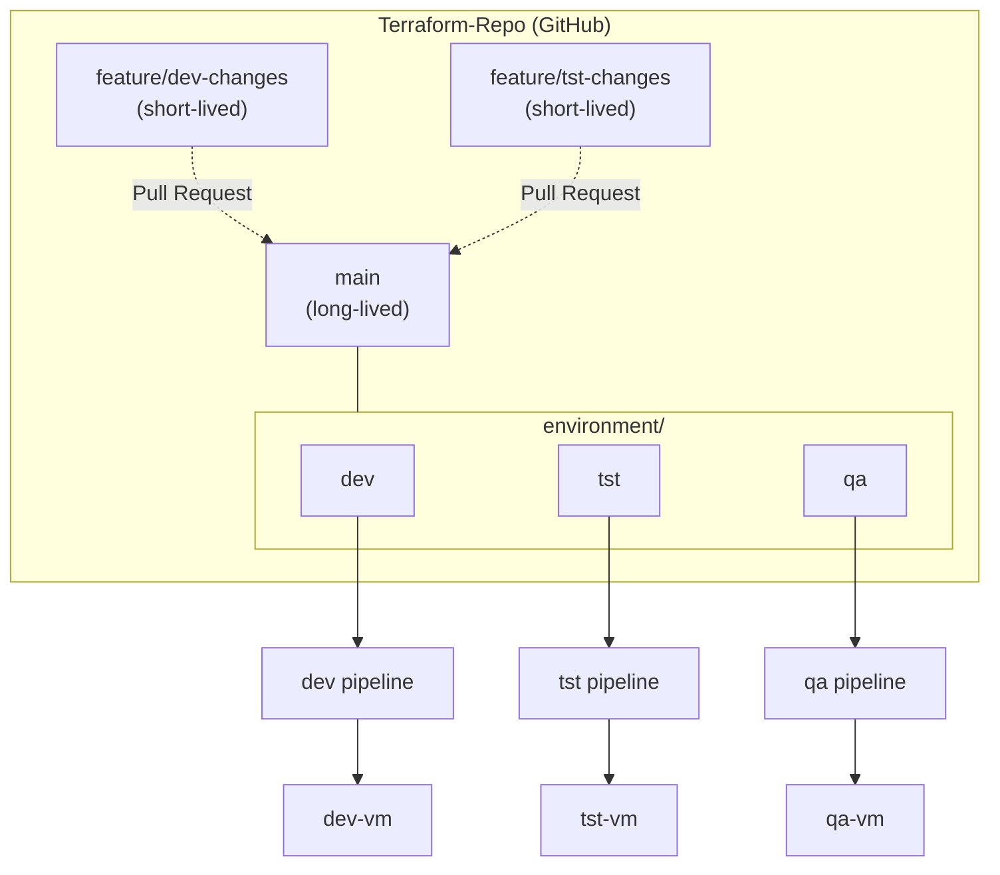
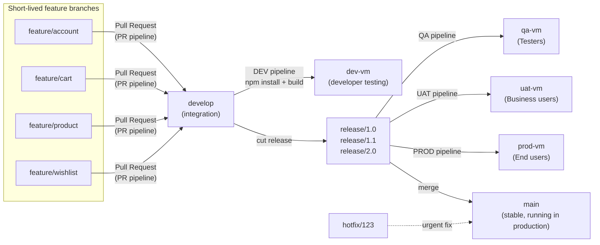
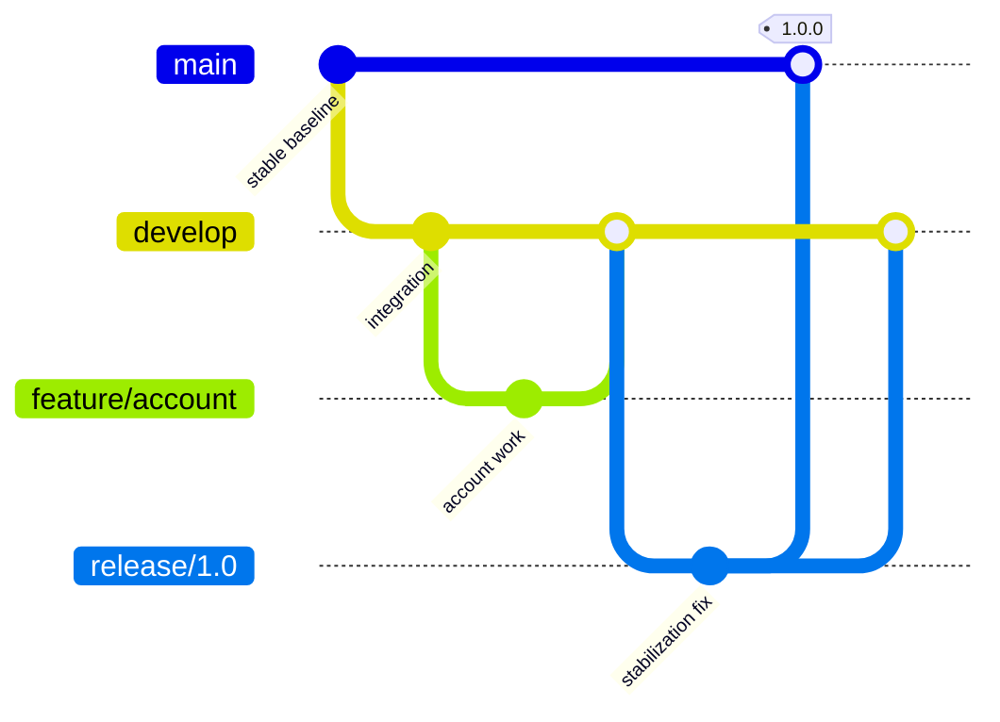
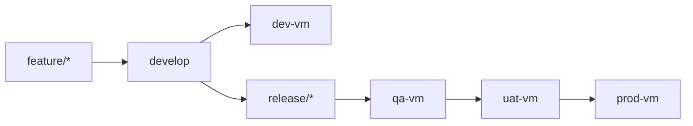
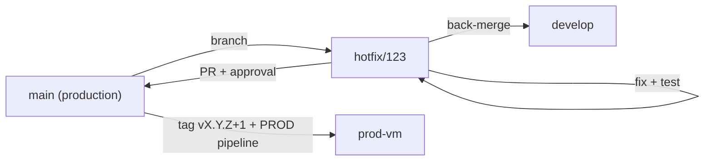

# Git Branching Strategy & CI/CD Pipeline with Environment-Based Deployments

> A reference implementation and documentation of two complementary Git workflows, **Trunk-Based Development** (for infrastructure code) and **Git Flow** (for application code), with automated CI/CD pipelines and promotion across **DEV → QA → UAT → PROD** environments.


---

## Table of Contents

1. [Overview](#1-overview)
2. [Architecture Diagram](#2-architecture-diagram)
3. [Two Workflow Patterns at a Glance](#3-two-workflow-patterns-at-a-glance)
4. [Pattern A: Trunk-Based Strategy (Terraform Repo)](#4-pattern-a-trunk-based-strategy-terraform-repo)
5. [Pattern B: Git Flow Strategy (todo-ui Repo)](#5-pattern-b-git-flow-strategy-todo-ui-repo)
6. [CI/CD Pipelines](#6-cicd-pipelines)
7. [Environments](#7-environments)
8. [Release Versioning (SemVer)](#8-release-versioning-semver)
9. [Hotfix Process](#9-hotfix-process)
10. [Branch Naming & Protection Rules](#10-branch-naming--protection-rules)
11. [Hybrid Workflow Option](#11-hybrid-workflow-option)
12. [Choosing a Strategy](#12-choosing-a-strategy)
13. [Assumptions & Open Points](#13-assumptions--open-points)
14. [Suggested Repository Structure](#14-suggested-repository-structure)
15. [Status and Roadmap](#status-and-roadmap)
16. [Author](#author)

---

## 1. Overview

This project documents a branching and delivery model derived from an architecture diagram that shows **two related but distinct workflows**:

| | Pattern A | Pattern B |
|---|---|---|
| **Name in diagram** | Trunk-based strategy | Git Flow branching strategy |
| **Repository in diagram** | `Terraform-Repo` | `todo-ui` |
| **Typical use** | Infrastructure as Code | Application (UI) delivery |
| **Environments** | `dev`, `tst`, `qa` | `dev`, `qa`, `uat`, `prod` |

**Goals**

- Keep integration frequent and changes small.
- Enforce quality gates through pull requests and automated pipelines.
- Promote the same build through progressively stricter environments.
- Version releases predictably with Semantic Versioning.
- Provide a safe, auditable path for emergency hotfixes.

> **Important:** These are two separate patterns. They can be evaluated independently, or combined into a hybrid (see [Section 11](#11-hybrid-workflow-option)). They are **not** one identical branching model.

---

## 2. Architecture Diagram

Place the source diagram in the repository and reference it here:

```markdown

```

<p align="center">
  
</p>

*Upper section: Trunk-based strategy. Lower section: Git Flow strategy.*

---

## 3. Two Workflow Patterns at a Glance

| Aspect | A: Trunk-Based (Terraform-Repo) | B: Git Flow (todo-ui) |
|---|---|---|
| Long-lived branches | `main` | `main`, `develop` (plus release branches while active) |
| Short-lived branches | `feature/dev-changes`, `feature/tst-changes` | `feature/account`, `feature/cart`, `feature/product`, `feature/wishlist`, `release/*`, `hotfix/*` |
| Integration point | `main` via Pull Request | `develop` via Pull Request |
| Environment mapping | Folders under `environment/` (`dev`, `tst`, `qa`) | Branch/pipeline stages (`dev`, `qa`, `uat`, `prod`) |
| Release mechanism | Merge to `main`, pipeline applies per environment | Dedicated `release/*` branches, stabilized, then merged to `main` |
| Production environment | Not shown in diagram | `prod-vm` |
| Release ceremony | Light | Formal (QA → UAT → PROD) |
| Best for | Fast-moving, small-change repos (IaC, config) | Versioned, scheduled releases with formal sign-off |

---

## 4. Pattern A: Trunk-Based Strategy (Terraform Repo)

### 4.1 Description

Infrastructure code lives in a single `Terraform-Repo` where **`main` is the only long-lived branch**. Engineers make small changes on short-lived feature branches and merge them back into `main` through Pull Requests.

Environment configuration is organized in an `environment/` structure containing `dev`, `tst`, and `qa`. Each environment has its own pipeline, which deploys to its own VM: `dev-vm`, `tst-vm`, and `qa-vm`.



### 4.2 Branches

| Branch | Lifetime | Purpose |
|---|---|---|
| `main` | Long-lived | Single source of truth for infrastructure code |
| `feature/dev-changes` | Short-lived | Changes targeting the `dev` environment configuration |
| `feature/tst-changes` | Short-lived | Changes targeting the `tst` environment configuration |

### 4.3 Workflow

1. Create a short-lived branch from the latest `main`.
2. Make a small, focused change (for example, in the `dev` environment folder).
3. Open a **Pull Request** to `main`.
4. Automated checks run (format, validate, plan; see below).
5. A reviewer approves the PR.
6. Merge to `main` and delete the feature branch.
7. The environment-specific pipeline deploys the change to its target VM.

### 4.4 How Automated Checks, PR Reviews, and Environment Deployments Support This Workflow

| Control | Purpose |
|---|---|
| `terraform fmt -check` | Enforces consistent formatting |
| `terraform validate` | Catches syntax and configuration errors early |
| `terraform plan` (posted to the PR) | Gives reviewers a preview of exactly what will change |
| Static / security scan (e.g. `tfsec`, `checkov`) | Detects insecure infrastructure before merge |
| Required PR review (CODEOWNERS) | Peer review, plus environment-owner approval for `qa` |
| Branch protection on `main` | No direct pushes; required status checks must pass |
| Per-environment pipeline | Each of `dev`, `tst`, `qa` deploys independently to its own VM |
| Environment approvals | Optional manual approval gate before `qa` apply |

### 4.5 Promotion Across Environments

The diagram shows three parallel environment pipelines (`dev`, `tst`, `qa`) fed from the `environment` structure in `main`. The recommended promotion order is:

```
dev  →  tst  →  qa
```

Change is applied to `dev` first, validated, then promoted to `tst` and `qa` through the same `main` branch (by updating each environment's configuration in a follow-up PR or via a gated pipeline stage).

> See [Assumptions](#13-assumptions--open-points): the diagram shows `dev`, `tst`, `qa` as a grouped `environment` structure under `main`, which this README interprets as **folders/configurations**, not separate long-lived branches.

---

## 5. Pattern B: Git Flow Strategy (todo-ui Repo)

### 5.1 Description

The `todo-ui` repository (a Node.js UI project with `src/`, `public/`, and `package.json`) follows a **Git Flow-style** model. Developers work on short-lived feature branches that merge into `develop`. When `develop` is ready to ship, a release branch is cut and promoted through QA and UAT before reaching production.



### 5.2 Illustrative Git Flow History



*This is a conceptual illustration of the standard Git Flow lifecycle; it is not a literal copy of the diagram.*

### 5.3 Branches

| Branch | Lifetime | Purpose |
|---|---|---|
| `main` | Long-lived | Most stable code, the code running in production. Every merge corresponds to a release. |
| `develop` | Long-lived | Integration branch for completed features. Source for DEV builds and release branches. |
| `feature/account` | Short-lived | Account functionality |
| `feature/cart` | Short-lived | Cart functionality |
| `feature/product` | Short-lived | Product functionality |
| `feature/wishlist` | Short-lived | Wishlist functionality |
| `release/1.0`, `release/1.1`, `release/2.0` | Temporary | Release stabilization and promotion through QA, UAT, PROD |
| `hotfix/123` | Short-lived | Example urgent production fix |

### 5.4 Feature Development

1. Developers branch from `develop` into `feature/<name>`.
2. Work is committed in small increments; branches are kept short-lived to limit merge conflicts.
3. A Pull Request into `develop` triggers the **PR pipeline**.
4. After review and a passing pipeline, the PR is merged.
5. Merges to `develop` trigger the **DEV pipeline**: `npm install` + build, then deploy to **`dev-vm`**.
6. Developers perform **developer testing** on `dev-vm`.

### 5.5 Release Stabilization

When `develop` contains the scope intended for a release:

1. Create `release/<version>` from `develop` (for example `release/1.0`).
2. **Feature freeze:** only bug fixes, documentation, and release metadata are allowed on the release branch.
3. The release candidate is deployed through **QA → UAT → PROD**.
4. Fixes found during QA/UAT are committed to the release branch and re-validated.
5. Once approved, the release is merged to `main`, tagged with its semantic version, and deployed to production.
6. The release branch is merged back into `develop` so fixes are not lost (standard Git Flow practice; see [Assumptions](#13-assumptions--open-points)).

**Why release branches?** They isolate a release candidate from ongoing feature work, so `develop` keeps moving while QA and UAT test a stable snapshot. The diagram shows multiple release branches (`release/1.0`, `release/1.1`, `release/2.0`), indicating that releases are cut in succession.

### 5.6 Testing & Sign-off

| Stage | Environment | Performed by | Focus |
|---|---|---|---|
| Developer testing | `dev-vm` | Developers | Smoke checks and integration sanity on latest `develop` |
| QA | `qa-vm` | Testers (diagram shows Tester1, Tester2, Tester3) | Functional, regression, and integration testing against the release branch |
| UAT | `uat-vm` | Business stakeholders | Business-acceptance validation; confirms the release meets business requirements |
| Production | `prod-vm` | End users | Live use after approval |

The diagram notes that **UAT is performed by business users** (annotation in Hindi: *"UAT ko test karne wale business ke log rahenge"*).

---

## 6. CI/CD Pipelines

### 6.1 Pipeline Overview

| Pipeline | Pattern | Typical Trigger | Responsibilities | Target |
|---|---|---|---|---|
| `dev` / `tst` / `qa` (infra) | A | Merge to `main` affecting that environment | Terraform init, validate, plan, apply | `dev-vm`, `tst-vm`, `qa-vm` |
| **PR pipeline** | B | Pull Request to `develop` | Install, lint, unit tests, build verification | None (validation only) |
| **DEV pipeline** | B | Merge/push to `develop` | `npm install` + build, deploy | `dev-vm` |
| **QA pipeline** | B | Release branch created or updated | Build release candidate, deploy | `qa-vm` |
| **UAT pipeline** | B | QA sign-off (gated) | Promote the QA-approved build | `uat-vm` |
| **PROD pipeline** | B | UAT sign-off + manual approval | Promote the approved build, tag version | `prod-vm` |

### 6.2 Pipeline Principles

- **Build once, deploy many.** Promote the same artifact from QA → UAT → PROD instead of rebuilding.
- **Gate each promotion.** QA sign-off before UAT, UAT sign-off before PROD.
- **Fail fast.** Lint, tests, and build checks run in the PR pipeline before code reaches `develop`.
- **Traceability.** Every deployment maps to a commit SHA and, for releases, a version tag.
- **Manual approval for PROD.** Production deployments require an explicit approval step.

### 6.3 Example: PR Pipeline (Azure Pipelines YAML)

> The pipeline icons in the diagram resemble Azure Pipelines. The examples below use that syntax, but the same stages translate directly to GitHub Actions or other CI/CD tools.

```yaml
# pr-pipeline.yml
trigger: none
pr:
  branches:
    include:
      - develop

pool:
  vmImage: ubuntu-latest

steps:
  - task: NodeTool@0
    inputs:
      versionSpec: '20.x'
  - script: npm ci
    displayName: Install dependencies
  - script: npm run lint --if-present
    displayName: Lint
  - script: npm test --if-present
    displayName: Unit tests
  - script: npm run build
    displayName: Build verification
```

### 6.4 Example: DEV Pipeline

```yaml
# dev-pipeline.yml
trigger:
  branches:
    include:
      - develop

pool:
  vmImage: ubuntu-latest

steps:
  - script: npm install
    displayName: npm install
  - script: npm run build
    displayName: Build
  - publish: build
    artifact: todo-ui-dev
  # Deploy step to dev-vm (SSH / deployment group / self-hosted agent)
```

### 6.5 Example: Release Promotion (QA → UAT → PROD)

```yaml
# release-pipeline.yml
trigger:
  branches:
    include:
      - release/*

stages:
  - stage: Build
    jobs:
      - job: BuildArtifact
        steps:
          - script: npm ci && npm run build
          - publish: build
            artifact: todo-ui

  - stage: QA
    dependsOn: Build
    jobs:
      - deployment: DeployQA
        environment: qa-vm          # environment checks configured in Azure DevOps
        strategy:
          runOnce:
            deploy:
              steps:
                - script: echo "Deploy to qa-vm"

  - stage: UAT
    dependsOn: QA
    jobs:
      - deployment: DeployUAT
        environment: uat-vm         # approval: business stakeholders
        strategy:
          runOnce:
            deploy:
              steps:
                - script: echo "Deploy to uat-vm"

  - stage: PROD
    dependsOn: UAT
    jobs:
      - deployment: DeployPROD
        environment: prod-vm        # approval: release manager
        strategy:
          runOnce:
            deploy:
              steps:
                - script: echo "Deploy to prod-vm"
```

### 6.6 Example: Terraform Environment Pipeline (Pattern A)

```yaml
# terraform-dev-pipeline.yml
trigger:
  branches:
    include:
      - main
  paths:
    include:
      - environment/dev/*

pool:
  vmImage: ubuntu-latest

steps:
  - script: terraform -chdir=environment/dev init
  - script: terraform -chdir=environment/dev fmt -check
  - script: terraform -chdir=environment/dev validate
  - script: terraform -chdir=environment/dev plan -out=tfplan
  - script: terraform -chdir=environment/dev apply -auto-approve tfplan
```

---

## 7. Environments

| Environment | VM | Pattern | Purpose | Audience |
|---|---|---|---|---|
| DEV | `dev-vm` | A and B | Early integration and developer testing | Developers |
| TST | `tst-vm` | A only | Test environment for infrastructure changes | Engineers |
| QA | `qa-vm` | A and B | Functional and regression testing | Testers |
| UAT | `uat-vm` | B only | Business acceptance testing | Business stakeholders |
| PROD | `prod-vm` | B only | Live production | End users |



---

## 8. Release Versioning (SemVer)

Releases follow [Semantic Versioning](https://semver.org/): `MAJOR.MINOR.PATCH`.

| Segment | Increment when | Example |
|---|---|---|
| **MAJOR** | Breaking changes | `1.x.x` → `2.0.0` |
| **MINOR** | New backward-compatible functionality | `1.0.0` → `1.1.0` |
| **PATCH** | Backward-compatible bug fixes (including hotfixes) | `1.1.0` → `1.1.1` |

**Mapping to the diagram:**

| Diagram label | Meaning in this README |
|---|---|
| `release/1.0` | Initial release line → tag `v1.0.0` |
| `release/1.1` | Minor release line → tag `v1.1.0` (with patch tags such as `v1.1.1` for fixes) |
| `release/2.0` | Major release line → tag `v2.0.0` |

The diagram labels branches as `release/1.0`, `release/1.1`, `release/2.0` and shows a "Semantic Version" annotation near the PROD pipeline. This README therefore treats **branch names as release lines** and **Git tags as full `MAJOR.MINOR.PATCH` versions**. If you prefer three-part branch names (for example `release/1.0.0`), the workflow is unchanged.

**Tagging a release:**

```bash
git checkout main
git merge --no-ff release/1.0
git tag -a v1.0.0 -m "Release 1.0.0"
git push origin main --tags
```

---

## 9. Hotfix Process

`hotfix/123` is shown in the diagram as an example hotfix branch (here, `123` is assumed to be an issue/ticket number).

**Purpose:** Fix a critical production defect without waiting for the next planned release.



**Steps (standard Git Flow practice):**

```bash
git checkout main && git pull
git checkout -b hotfix/123
# ...implement and test the fix...
git push -u origin hotfix/123
# Open PR -> main, get approval, run required checks
# After merge: bump PATCH version and tag
git tag -a v1.1.1 -m "Hotfix 123"
git push origin --tags
# Back-merge into develop (or the active release branch) so the fix is not lost
```

---

## 10. Branch Naming & Protection Rules

### 10.1 Naming Conventions

| Type | Pattern | Example |
|---|---|---|
| Feature | `feature/<short-name>` | `feature/cart` |
| Release | `release/<major>.<minor>` | `release/1.1` |
| Hotfix | `hotfix/<ticket-id>` | `hotfix/123` |
| Infra change (Pattern A) | `feature/<env>-changes` | `feature/dev-changes` |

### 10.2 Recommended Branch Protection

| Branch | Rules |
|---|---|
| `main` | No direct pushes; PR required; ≥1 approval (≥2 recommended); required status checks; linear history or `--no-ff` merges; restrict who can merge |
| `develop` | No direct pushes; PR required; PR pipeline must pass |
| `release/*` | PR required for fixes; restricted to release owners |
| `feature/*`, `hotfix/*` | Delete after merge |

### 10.3 Pull Request Checklist

- [ ] Small and focused change
- [ ] PR pipeline / required checks are green
- [ ] At least one reviewer approved
- [ ] Documentation and tests updated if relevant
- [ ] Linked to a work item or ticket

---

## 11. Hybrid Workflow Option

The two patterns can be adapted into a hybrid depending on the team's needs:

| Hybrid idea | Description |
|---|---|
| **Different repos, different strategies** | Use trunk-based for infrastructure (`Terraform-Repo`) and Git Flow for the application (`todo-ui`), which is exactly what the diagram shows. |
| **Trunk-based application with release tags** | Drop `develop`; merge features straight to `main` behind feature flags, cut `release/*` only when a hotfix line is needed. |
| **Git Flow + shorter cycles** | Keep `develop` and release branches, but cut releases frequently and keep features very short-lived to approximate trunk-based integration speed. |
| **Environment promotion for IaC** | Apply the QA → UAT → PROD gate model to Terraform by adding `uat` and `prod` environments to the `environment/` structure. |

---

## 12. Choosing a Strategy

| Choose **Trunk-Based** when… | Choose **Git Flow** when… |
|---|---|
| You deploy frequently and want minimal branching overhead | You ship scheduled, versioned releases |
| Strong automated testing and feature flags exist | Formal QA and UAT sign-off are mandatory |
| Changes are small and independent (typical for IaC) | Multiple release versions must be supported |
| Team is small to medium and communicates well | Compliance requires explicit release gates |

---

## 13. Assumptions & Open Points

This README follows the diagram as the source of truth. Where the diagram is ambiguous or silent, the following assumptions were made. Please verify them against your actual setup.

| # | Area | What the diagram shows | Assumption in this README |
|---|---|---|---|
| 1 | Environment structure (Pattern A) | `dev`, `tst`, `qa` grouped under an `environment` box inside `main` | Treated as **folders/configurations in `main`**, not long-lived branches |
| 2 | PR direction (Pattern A) | Dashed arrows between feature branches and `main`, with a "PR" label | Feature branches are created from `main` and merged back via PR |
| 3 | Feature-to-environment mapping (A) | `feature/dev-changes` and `feature/tst-changes` | Each branch changes the config of its named environment |
| 4 | Promotion order (A) | Three parallel pipelines | Recommended order `dev → tst → qa`; not an explicit arrow in the diagram |
| 5 | Release branch names (B) | `release/1.0`, `release/1.1`, `release/2.0` | Used as shown; tags use full SemVer (e.g. `v1.0.0`). Names like `release/1.0.0` or `1.1.1` are equally valid |
| 6 | Release-to-pipeline mapping (B) | Connectors from release branches to QA, UAT, and PROD pipelines; a dashed line from `release/1.1` towards `main`/PROD | The **same release candidate** is promoted QA → UAT → PROD; the exact branch-to-pipeline wiring in the diagram is not fully legible |
| 7 | Merge into `main` (B) | An arrow from the release area to `main` (labeled "most stable code that is running in production") | Release branches are merged into `main` upon approval |
| 8 | Back-merge to `develop` (B) | Not shown | Added as standard Git Flow practice |
| 9 | Hotfix flow (B) | `hotfix/123` appears with no connectors | Branched from `main`, merged to `main` and back-merged to `develop` (standard Git Flow) |
| 10 | "Long Lived" labels (B) | An orange "Long Lived branch" label near the release/hotfix area | Interpreted as applying to `main` (and `develop`); release/hotfix branches are treated as **temporary** |
| 11 | PR pipeline (B) | Dashed connector from `feature/account` to the PR pipeline and then `develop` | Applies to **all** feature branches |
| 12 | CI/CD tool | Blue pipeline icons resembling Azure Pipelines | YAML samples use Azure Pipelines syntax; GitHub Actions is an equivalent alternative |
| 13 | Production for Pattern A | No `prod` environment shown | Out of scope; can be added later |
| 14 | `hotfix/123` | Only a label | `123` assumed to be an issue/ticket ID |

---

## 14. Suggested Repository Structure

```text
.
├── README.md
├── docs/
│   └── images/
│       └── architecture-diagram.png
├── pipelines/
│   ├── pr-pipeline.yml
│   ├── dev-pipeline.yml
│   ├── release-pipeline.yml          # QA → UAT → PROD
│   └── terraform-env-pipeline.yml
├── terraform/                        # Pattern A example
│   └── environment/
│       ├── dev/
│       ├── tst/
│       └── qa/
└── .github/
    ├── CODEOWNERS
    └── pull_request_template.md
```

---


## Status and Roadmap

This repository documents the two workflows and provides starter templates. Current state:

| Area | Status |
|---|---|
| Branching strategy documentation | Complete |
| Pipeline YAML (`pipelines/`) | Templates. Deployment steps to the VMs are placeholders |
| Terraform (`terraform/environment/`) | Skeleton per environment (resource group only), not applied |
| Live pipeline runs | Not configured yet |

Roadmap:

- [ ] Add network and VM resources to the Terraform environments
- [ ] Run the pipelines against a real Azure DevOps project or GitHub Actions
- [x] Demonstrate the Git Flow lifecycle in this repo (`develop`, `feature/*`, `release/1.0`, tag `v1.0.0`)
- [ ] Enable branch protection on `main`
## Author

**Aniket Kumar**

This repository documents Git branching strategies and CI/CD promotion workflows (trunk-based development and Git Flow) with environment-based deployments.

### Connect

- GitHub: [github.com/aniket-devop](https://github.com/aniket-devop)
- LinkedIn: [linkedin.com/in/aniket484](https://www.linkedin.com/in/aniket484/)

Suggestions and corrections are welcome through issues or pull requests.

## License

Released under the [MIT License](LICENSE). Copyright (c) 2026 Aniket Kumar.

